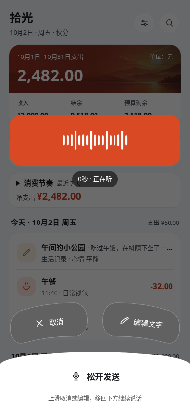
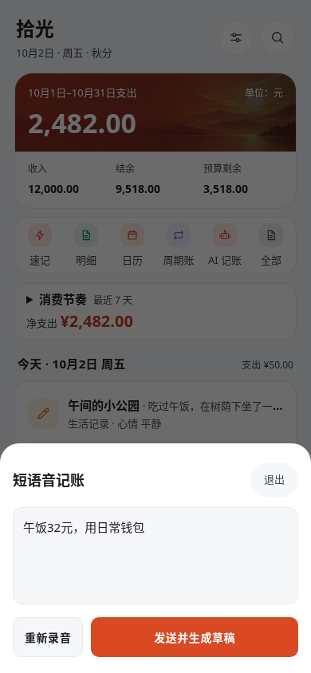
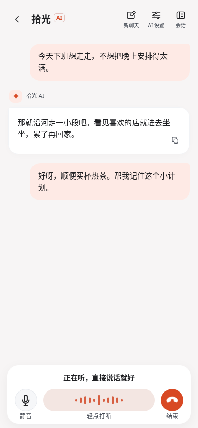
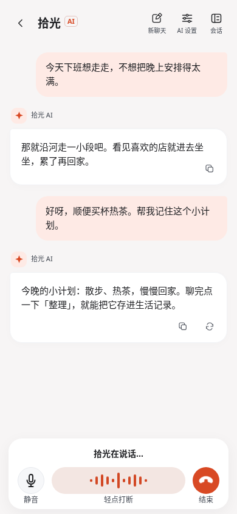
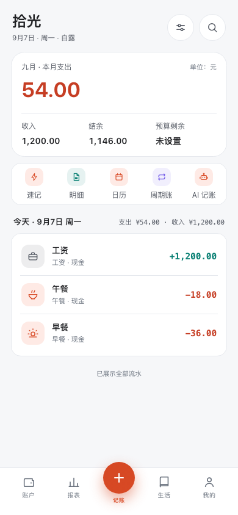
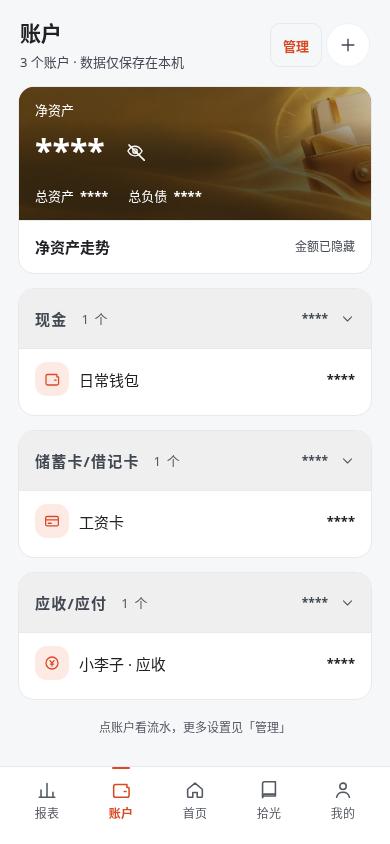
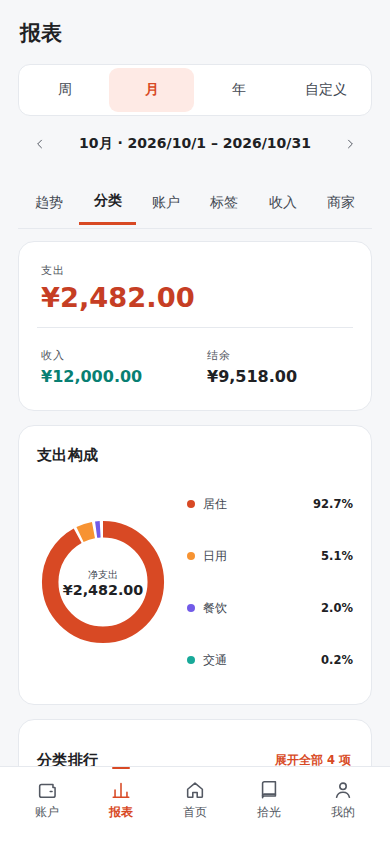
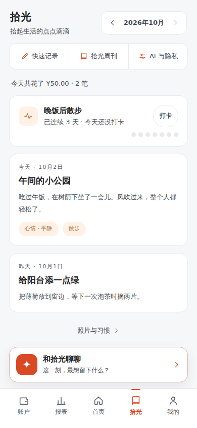
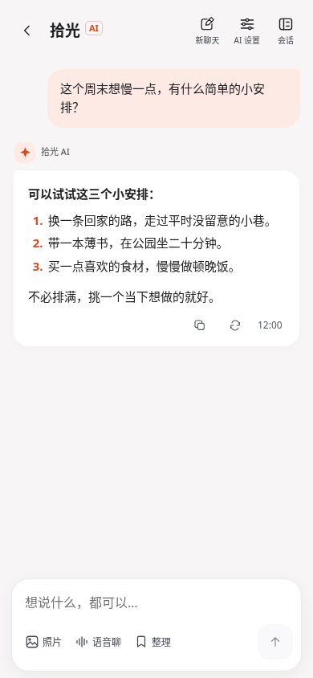
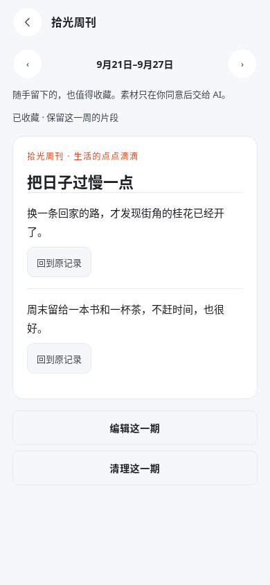

# 拾光 Gleam

https://github.com/user-attachments/assets/e23ed9e9-f84b-4ba6-a50a-91313b2ed70b

**[下载 1080p 原片](docs/assets/promo/gleam-warm-life.mp4?raw=true)** · 64 秒 · [查看封面](docs/assets/promo/gleam-warm-life-cover.jpg) · [v1.11.36](https://github.com/luwenyan02/Gleam/releases/tag/v1.11.36)

**记账，也记生活。**

午饭花了 32 元，长按说一句，核对后就记到账上。月底翻翻账本，看看钱花在哪里；想记住的一天，写几句、放张照片，也可以直接和拾光聊聊。

拾光把账本、生活记录和 AI 对话放在一个应用里。无需注册，账目和日记默认保存在自己的设备上。日常记账可以离线使用，AI 和云备份按需配置。

[](https://github.com/luwenyan02/Gleam/releases/latest) [](#开始使用) [](https://github.com/luwenyan02/Gleam/releases/latest)

**[下载 Android 安装包](https://github.com/luwenyan02/Gleam/releases/latest)** · [看看界面](#看看界面) · [数据与备份](docs/data-backup.md) · [本地运行](#本地运行)

这份介绍以 **v1.11.36** 已发布功能为准。视频使用虚构账目；语音及部分 AI 内容为模拟演示。

## 看看界面

以下是 v1.11.32 网页生产构建的真实截图，使用虚构账目与本地模拟 AI 回复；语音画面通过模拟原生通道展示，未实际收音。点击可查看原图；[截图来源与复现方法](docs/assets/screenshots/README.md)单独记录。

<!-- SCREENSHOTS_START -->
### 开口记账，顺手聊聊

长按首页「+」说一笔开销，滑到「编辑文字」还能改好再发。语音聊则留在聊天页底部，听你说，也能随时打断。

| 短语音记账 · 按住说话 | 转成文字 · 改好再发 |
| --- | --- |
| [](docs/assets/screenshots/voice-recording-demo.png) | [](docs/assets/screenshots/voice-editing-demo.png) |

| 语音聊 · 正在听 | 语音聊 · 拾光在说话 |
| --- | --- |
| [](docs/assets/screenshots/voice-listening-demo.png) | [](docs/assets/screenshots/voice-speaking-demo.png) |

### 账本和生活记录

| 首页 | 账户 | 报表 |
| --- | --- | --- |
| [](docs/assets/screenshots/home-demo.png) | [](docs/assets/screenshots/accounts-demo.png) | [](docs/assets/screenshots/report-demo.png) |

| 生活记录 | 和拾光聊聊 | 拾光周刊 |
| --- | --- | --- |
| [](docs/assets/screenshots/life-demo.png) | [](docs/assets/screenshots/chat-demo.png) | [](docs/assets/screenshots/weekly-demo.png) |
<!-- SCREENSHOTS_END -->

[再看看借贷记账界面](docs/assets/screenshots/loan-demo.png)。

## 随手记一笔，复杂的账也能理清

常用的分类和账户会结合记账时间和使用习惯在本机推荐，金额框里可以直接计算。同类开销用模板，固定支出设周期账，付款截图可以附在账单上。

- **说一句就能记**：Android 首页长按「+」说话，松开后生成草稿；想改文字就滑到编辑，金额、分类和账户核对后再保存。
- **收支以外的事也有专门入口**：转账、借出借入、还款、退款和报销分别处理；借贷能查到资金账户和应收应付账户之间的往来。
- **旧账不用重抄**：支持微信、支付宝、挖财账单导入，以及 Excel 导入导出。普通账单可附最多 9 张图片凭证。
- **截图也能识别**：配置 AI 后，可从文字或图片提取账单。识别结果可在收件箱核对，达到阈值且分类、账户匹配完整时，可按设置自动入账；语音记账始终由你确认保存。

## 想查一笔，或看清一个月

记下来的账可以按日历翻，也可以用关键词、账户、分类、标签和商家组合筛选。流水多时，快速滑动会唤出右侧的快滑胶囊：拖动定位，或一键回到顶部、跳到已加载流水的末尾；停下来后自动收起。需要更早的记录，再到底部继续上拉加载。

账户页可以看余额、逐笔余额变化和净资产走势，管理信用卡账单、额度与还款。报表支持周、月、年和自定义时段，预算也能按自己的财务月安排。

想让 AI 帮忙分析时，可以问「最近 30 天花了多少」「这个月哪里花得多」，或看上月对比、近 6 个月趋势。先确认分析范围，拾光在本机算好汇总，再交给模型解释；结果可以回到原账单核对，聊天不会自动改账。

## 打字聊，也可以直接开口

「拾光」里可以记随笔、加照片、打卡习惯，也可以打开聊天，说说今天的事。聊完点击「整理」，修改成自己想留下的文字再保存；从首页记录还能回到原始对话。

- **Android 语音聊**：点击开始，连接后直接说话，拾光会语音回答；可以打断、静音或结束。转写留在聊天记录里，文字与语音切换时，上方消息保持原位。
- **图片和图表**：聊天图片可以打开、保存和分享；数据可以用折线图、柱状图或环形图查看，点选数值、展开数据表，也能导出 PNG。
- **需要时查新信息**：支持已适配百炼模型的联网搜索，是否搜索由模型根据问题判断。
- **选自己用的模型**：内置阿里百炼、OpenAI、DeepSeek、硅基流动、Moonshot Kimi、智谱六个平台预设，区分推荐、近期更新和兼容旧版，也支持自填模型。图片能力会单独标注，更新预设会保留当前配置。

一周结束，还可以挑几条生活记录，整理成「拾光周刊」，预览、编辑后收藏。

## 数据留在手里

账单、生活记录、会话和附件默认保存在本机，不需要注册拾光账号。完整数据可以导出为加密 `.skbak` 备份，也可以备份到自己的 WebDAV、S3 兼容存储，或在 Android 上通过 QQ 邮箱发送加密备份。换设备时，用备份文件恢复。

聊天与附件点击发送后、语音连接后，会发送给你配置的 AI 服务；整理记录、生成周刊和分析账单数据前，会先确认发送内容。使用云盘或邮件备份时，备份文件会发送到你指定的目的地。服务密钥不打包进数据备份，换设备后需要重新配置。具体范围见[隐私说明](PRIVACY.md)。

卸载、清除应用数据或更换设备前，请把加密备份另存一份，并保管好口令。Excel 适合整理账目，完整迁移请使用 `.skbak`。

## 开始使用

**Android 7.0 及以上**：在 [Releases](https://github.com/luwenyan02/Gleam/releases/latest) 下载 APK，页面同时提供 SHA-256 校验文件。安装后即可手动记账；已有版本可从「我的 → 关于和帮助 → 关于拾光」检查新版，升级说明见对应 Release。

**AI 功能**：在设置中选择平台、模型并填写自己的 API Key。图片识别需要支持图片的模型；Android 短语音和语音聊使用阿里百炼，需要完成语音配置与连接测试，服务可能按用量收费。[短语音记账](docs/SHORT_VOICE_ENTRY.md)和[语音聊](docs/REALTIME_VOICE.md)有具体说明。

**PWA**：自行运行网页后可安装为网页应用，核心记账与记录功能可离线使用。开发网页版语音聊需要额外配置本机中转，离线 PWA 不包含该服务；Android 语音功能直接使用原生通道。

<details>
<summary>使用过早期 v1.8.0／v1.8.1 云端签名包？</summary>

这两个云端版本与当前版本的签名不同，不能直接覆盖安装。请先导出加密备份，另存到应用之外并确认可读取，再安排卸载、安装与恢复。其他原签名版本无需仅因版本旧而卸载。细节见[发布指南](docs/release.md)。

</details>

## 本地运行

项目使用 TypeScript、Vite、Dexie 和 Capacitor。网页端与 Android 共用应用代码，数据保存在设备端。

需要 Node.js 22 和 npm 10；端到端测试另需 Python 3.11+ 与 Playwright。安装依赖：

```sh
cd app
npm ci
```

日常 OrbStack 预览在仓库根目录启动，地址为 `http://localhost:5173/`：

```sh
sh scripts/preview-local.sh up
```

未使用 OrbStack 常驻预览时，可在 `app/` 下运行：

```sh
npm run dev -- \
  --host 127.0.0.1 --port 5173 \
  --strictPort
```

两个入口选择一个，避免占用同一端口。云环境初始化与验证见[云环境指南](docs/CLOUD_DEVELOPMENT.md)；Android 构建、原证书签名和产物核验见[发布指南](docs/release.md)。

[开发指南](docs/development.md) · [架构说明](docs/architecture.md) · [参与维护](CONTRIBUTING.md) · [项目状态](docs/PROJECT_STATUS.md) · [版本记录](https://github.com/luwenyan02/Gleam/releases)
